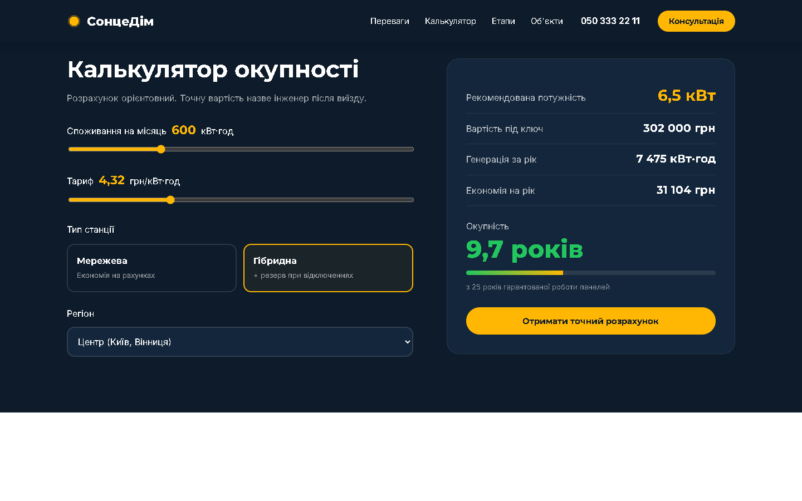

# СонцеДім — лендінг монтажу сонячних станцій

Посадкова сторінка для компанії, що встановлює сонячні електростанції.




## Що всередині

- **Калькулятор окупності** — підбирає потужність станції під споживання і регіон, рахує вартість (мережева / гібридна з АКБ), річну генерацію, економію і строк окупності. Коефіцієнти винесені на початок `src/js/calculator.js`.
- **Анімації на GSAP** — поява першого екрана, блоків при прокрутці (`ScrollTrigger.batch`), лічильники, паралакс фону. При `prefers-reduced-motion` анімації вимкнені.
- **Форма заявки** — нормалізація та перевірка телефону, honeypot від ботів. Заявка разом із результатом калькулятора йде у serverless-функцію `api/lead.js`, яка надсилає її менеджеру в Telegram.
- Адаптивна верстка від 320 px, SCSS з міксинами для брейкпоінтів.
- Зображення в WebP через `<picture>`, `loading="lazy"` для всього нижче першого екрана.

## Стек

HTML, SCSS, JavaScript (ES-модулі), GSAP, Vite. Функція заявок — під Vercel.

## Запуск

```bash
npm install
npm run dev
```

Збірка: `npm run build`.

## Деплой (Vercel)

1. Імпортувати репозиторій у Vercel — Vite визначиться автоматично.
2. Додати змінні `TELEGRAM_BOT_TOKEN` і `TELEGRAM_CHAT_ID` (приклад у `.env.example`).

Фото — Unsplash. Ціни в калькуляторі орієнтовні.
